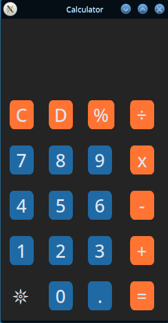
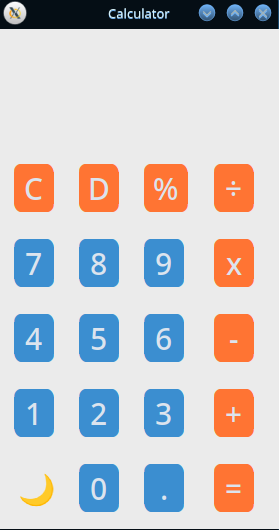
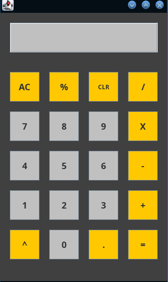

# Desktop Calculator Applications

A multi-language collection of desktop calculator applications featuring graphical user interfaces (GUI) built with **Python (CustomTkinter)** and **Java (Swing)**. Each implementation demonstrates GUI design patterns, event-driven user interaction, and arithmetic expression evaluation.

---

## 📸 Preview Gallery

### Python Calculator (CustomTkinter)
<p align="center">
  
  &nbsp;&nbsp;&nbsp;&nbsp;&nbsp;&nbsp;&nbsp;&nbsp;
  
</p>
<p align="center"><em>Dark Mode (𖤓) and Light Mode (🌙)</em></p>

### Java Calculator (Swing)
<p align="center">
  
</p>
<p align="center"><em>Classic Java Swing GUI</em></p>

---

## 🗂 Project Overview

| Project | Language | GUI Framework | Key Features | Documentation |
| :--- | :--- | :--- | :--- | :--- |
| **[Python Calculator](calculator_python/)** | Python 3.8+ | [CustomTkinter](https://github.com/TomSchimansky/CustomTkinter) | Real-time calculation previews, dark/light theme switching, modern flat aesthetic | [Python README](calculator_python/README.md) |
| **[Java Calculator](calculator_java/)** | Java 8+ | Java Swing (`JFrame`, `JButton`, `JTextField`) | Power/exponentiation (`^`), percentage (`%`), single-character backspace (`CLR`), all-clear (`AC`) | [Java README](calculator_java/README.md) |

---

## 🚀 Quick Start

### 1. Python GUI Calculator

A modern calculator with live calculation preview and dynamic theme toggling.

#### Prerequisites
- Python 3.8 or higher
- System `tkinter` package (Linux users only)

#### Setup & Run
```bash
# Navigate to the Python calculator directory
cd calculator_python

# (Optional) Create and activate a virtual environment
python3 -m venv venv
source venv/bin/activate       # On Windows: venv\Scripts\activate

# Install required packages
pip install -r requirements.txt

# Launch the calculator
python calculator/main.py
```

> **Note for Linux users:** If `tkinter` is missing, install it via your package manager (e.g., `sudo apt-get install python3-tk` on Ubuntu/Debian or `sudo pacman -S tk` on Arch).

---

### 2. Java GUI Calculator

A classic desktop calculator built using native Java Swing components.

#### Prerequisites
- Java Development Kit (JDK) 8 or higher (JDK 11, 17, or 21 recommended)

#### Compile & Run
```bash
# Navigate to the Java calculator directory
cd calculator_java

# Compile the source code into the output directory
javac -d out src/calculator/Calculator.java

# Run the compiled application
java -cp out calculator.Calculator
```

Alternatively, you can compile and run directly from `src`:
```bash
cd calculator_java
javac src/calculator/Calculator.java
java -cp src calculator.Calculator
```

---

## 📁 Repository Structure

```text
.
├── calculator_java/                 # Java Swing Calculator implementation
│   ├── src/                         # Java source code
│   │   └── calculator/
│   │       └── Calculator.java      # Main calculator application class
│   ├── screenshot/                  # Application preview screenshots
│   │   └── Screenshot_20261101_090201.png
│   ├── build.xml                    # Ant build configuration
│   ├── manifest.mf                  # JAR manifest metadata
│   ├── .gitignore                   # Java-specific Git ignore rules
│   └── README.md                    # Java project documentation
│
├── calculator_python/               # Python CustomTkinter Calculator implementation
│   ├── calculator/                  # Python package source code
│   │   ├── __init__.py
│   │   └── main.py                  # Main application entry point
│   ├── screenshots/                 # Application preview screenshots
│   │   ├── Screenshot_20261101_091946.png
│   │   └── Screenshot_20261101_092020.png
│   ├── requirements.txt             # Python dependencies (customtkinter)
│   ├── .gitignore                   # Python-specific Git ignore rules
│   └── README.md                    # Python project documentation
│
└── README.md                        # Root repository documentation
```

---

## ✨ Feature Comparison

| Feature | Python Calculator | Java Calculator |
| :--- | :---: | :---: |
| **Basic Arithmetic (`+`, `-`, `×`, `÷`)** | ✅ | ✅ |
| **Decimal Point (`.`)** | ✅ | ✅ |
| **Percentage (`%`)** | ✅ | ✅ |
| **Exponentiation / Power (`^`)** | ➖ | ✅ |
| **Live / Real-Time Result Preview** | ✅ | ➖ |
| **Dark / Light Theme Toggle** | ✅ | ➖ |
| **Character Backspace** | ✅ (`D`) | ✅ (`CLR`) |
| **Clear All / Reset** | ✅ (`C`) | ✅ (`AC`) |

---

## 🤝 Contributing

Contributions, bug reports, and suggestions are welcome! Feel free to:
1. Fork the repository.
2. Create your feature branch (`git checkout -b feature/NewFeature`).
3. Commit your changes (`git commit -m "Add new feature"`).
4. Push to the branch (`git push origin feature/NewFeature`).
5. Open a Pull Request.

---

## 📄 License

This repository is licensed under the [MIT License](LICENSE) (or open for personal/educational use).
