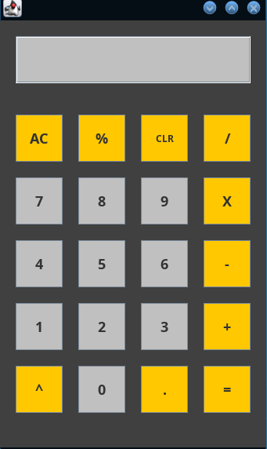

# Java GUI Calculator

A desktop calculator application built using Java and Swing. It features an intuitive graphical interface and supports basic arithmetic and common mathematical operations.

<p align="center">
  
</p>

---

## Features

- **Standard Operations:** Addition (`+`), Subtraction (`-`), Multiplication (`X`), Division (`/`).
- **Advanced Operations:**
  - Exponentiation / Power (`^`)
  - Percentage calculation (`%`)
- **Display & Editing Controls:**
  - `CLR`: Removes the last entered character (backspace).
  - `AC`: All Clear — resets current inputs and operations.
  - `.`: Floating-point / decimal point support.
- **Graphical User Interface:** Built with Java Swing (`JFrame`, `JButton`, `JTextField`) featuring a clean, responsive layout.

---

## Requirements

- **Java Development Kit (JDK):** Version 8 or higher (Java 11, 17, or 21 recommended).

---

## How to Compile and Run

### 1. Compile the Source Code

From the project root directory, run:

```bash
javac -d out src/calculator/Calculator.java
```

### 2. Run the Application

```bash
java -cp out calculator.Calculator
```

Alternatively, you can compile and run directly inside the `src` folder:

```bash
javac src/calculator/Calculator.java
java -cp src calculator.Calculator
```

---

## Project Structure

```text
├── screenshot/
│   └── Screenshot_20261101_090201.png
├── src/
│   └── calculator/
│       └── Calculator.java
├── .gitignore
└── README.md
```
