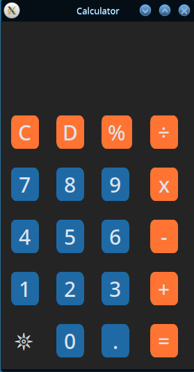
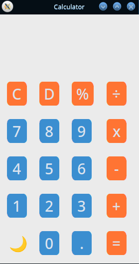

# Python GUI Calculator

A modern, sleek desktop calculator application built using Python and [CustomTkinter](https://github.com/TomSchimansky/CustomTkinter). It features real-time calculation previews, standard arithmetic operations, and dynamic Light/Dark theme switching.

<p align="center">
  
  &nbsp;&nbsp;&nbsp;&nbsp;
  
</p>

---

## Features

- **Standard Arithmetic Operations:** Addition (`+`), Subtraction (`-`), Multiplication (`x`), and Division (`÷`).
- **Percentage Calculations:** Computes percentages using `%`.
- **Live / Real-Time Calculation:** Automatically evaluates and displays the result as you enter expressions.
- **Dynamic Theme Toggling:** Switch seamlessly between Dark (`𖤓`) and Light (`🌙`) appearance modes with automatic text color adjustments.
- **Input & Display Controls:**
  - `C`: Clears all input and resets the display.
  - `D`: Backspace function to delete the last entered digit or operator.
  - `=`: Commits and highlights the final calculated result.
  - `.`: Decimal point support for floating-point calculations.
- **Modern User Interface:** Built with CustomTkinter featuring clean rounded buttons and distinct accent styling.

---

## Requirements

- **Python:** Version 3.8 or higher.
- **CustomTkinter:** Modern UI library built on top of Tkinter (`customtkinter>=5.2.0`).
- **Tkinter (Linux):** Ensure system Tkinter package is installed if your Python build does not bundle it.

---

## Installation & Setup

### 1. Navigate to the Project Directory

```bash
cd calculator_python
```

### 2. (Optional) Create and Activate a Virtual Environment

- **Linux / macOS:**
  ```bash
  python3 -m venv venv
  source venv/bin/activate
  ```

- **Windows:**
  ```bash
  python -m venv venv
  venv\Scripts\activate
  ```

### 3. Install Dependencies

```bash
pip install -r requirements.txt
```

> **Note for Linux users:** If `tkinter` is not pre-installed on your system, install it using your distribution's package manager:
> - **Ubuntu / Debian:** `sudo apt-get install python3-tk`
> - **Fedora:** `sudo dnf install python3-tkinter`
> - **Arch Linux:** `sudo pacman -S tk`

---

## How to Run

Run the calculator with:

```bash
python calculator/main.py
```

or:

```bash
python3 calculator/main.py
```

---

## Project Structure

```text
calculator_python/
├── calculator/
│   ├── __init__.py
│   └── main.py
├── screenshots/
│   ├── Screenshot_20261101_091946.png
│   └── Screenshot_20261101_092020.png
├── .gitignore
├── README.md
└── requirements.txt
```
